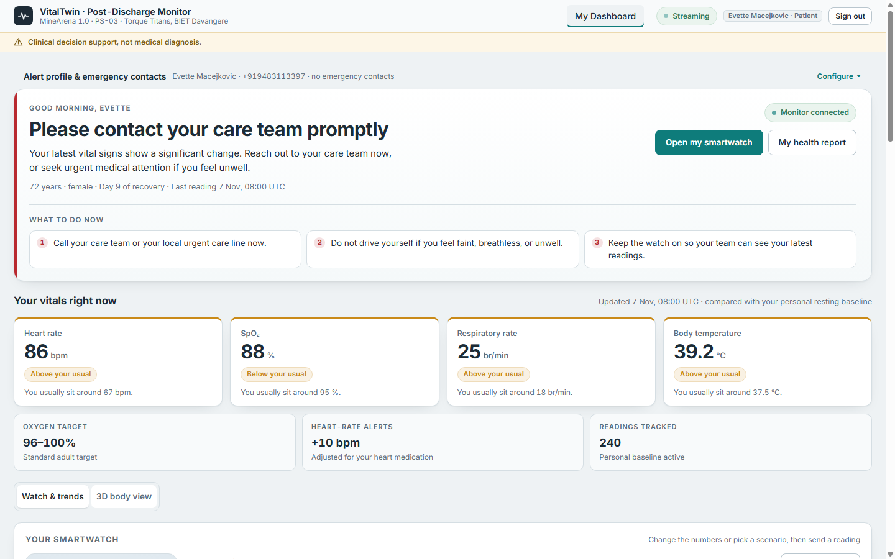
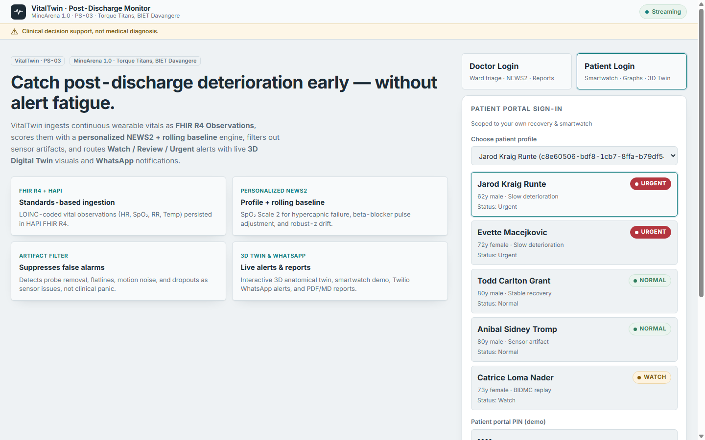

# VitalTwin — Personalized Post-Discharge Deterioration Monitor

**PS-03 · MineArena 1.0 · Team Torque Titans, BIET Davangere**

VitalTwin watches patients during the risky first weeks after hospital discharge. Wearable vitals arrive as **FHIR R4 Observations**, are scored with a **personalized NEWS2 + rolling baseline**, filtered for **sensor artifacts**, and routed as **Watch / Review / Urgent** alerts to the care team and family — with an interactive **3D body twin** and exportable **PDF / Markdown clinical reports**.

> Synthetic data only. Clinical decision support, not a medical diagnosis.



## What it does

- **Standards-based ingestion.** LOINC-coded vital observations (HR, SpO₂, respiratory rate, temperature) persisted in **HAPI FHIR R4**.
- **Personalized scoring.** NEWS2 adjusted per discharge profile: SpO₂ Scale 2 for documented hypercapnic failure, beta-blocker pulse adjustment, and robust-z drift against each patient's own rolling baseline.
- **Artifact filter.** Probe removal, flatlines, motion noise and dropouts are classified as sensor issues instead of clinical emergencies.
- **Explained alerts.** Every Watch / Review / Urgent decision states the reading, the rule and the profile fact behind it.
- **Two portals.** A doctor ward view and a scoped patient view, both protected by demo sign-in.
- **Multi-party alerting.** Urgent alerts reach the clinician, the patient and configured family/emergency contacts over WhatsApp; clinicians also get Telegram. Clinical reports can be emailed (Resend) and sent weekly.
- **Optional AI assistant.** Inbound WhatsApp questions are answered from the active patient's context when a Groq or OpenRouter key is configured.

## Portals

| Portal | URL | Contents |
|---|---|---|
| Landing | `/` | Project overview with **Patient Login** / **Doctor Login** |
| Doctor | `/monitor#/signin?role=doctor` | 5-patient ward census, patient drilldown, NEWS2 and drift detail, artifact log, FHIR explorer, performance report, PDF/MD export |
| Patient | `/monitor#/signin?role=patient` | Smartwatch simulator, vital trends, 3D body twin, medications, personal health summary |
| Twin sandbox | `/monitor#/legacy/overview` | Original physiology twin demo (separate from PS-03 scoring) |



## Architecture

```text
wearable / replay ──► FastAPI ingestion ──► HAPI FHIR R4 (Observations)
                            │
                            ├─► personalized NEWS2 + rolling baseline + artifact filter
                            ├─► SQLite (twins, alerts, report automation, alert profiles)
                            └─► alert router ─► Twilio WhatsApp (clinician, patient, family)
                                              └► Telegram ─► Resend email reports

React 19 + Vite SPA  ◄──── REST + WebSocket ────  FastAPI (one process on :8000)
```

- Backend: FastAPI, SQLAlchemy, SQLite, httpx, XGBoost risk model, Twilio, Resend.
- Frontend: React 19, TypeScript, Vite, Three.js / react-three-fiber, Recharts, jsPDF.
- Clinical: Synthea discharge profiles, BIDMC replay recordings, public sample data.

## Quick start

**Prerequisites:** Python 3.11+, Node.js 20+ (frontend build), Java 17 (only for the bundled HAPI FHIR server). Docker is optional.

```bash
git clone https://github.com/VidyaSAddanagi24/Digital-Health-Twin.git
cd Digital-Health-Twin

python -m venv .venv
# Windows:  .venv\Scripts\activate
# macOS/Linux:  source .venv/bin/activate
pip install -r requirements-dev.txt

cp .env.example .env        # Windows: copy .env.example .env
```

Start the FHIR server once (downloads HAPI into the git-ignored `vendor/`):

```bash
python scripts/setup_hapi.py
scripts/start_hapi.bat      # Windows  (http://localhost:8090/fhir)
./scripts/start_hapi.sh     # macOS/Linux
```

Keep `DHT_HAPI_BASE_URL` in `.env` in sync with that port (the example uses `8090`).

Build the frontend, then run the app:

```bash
cd frontend && npm ci && npm run build && cd ..
python -m uvicorn backend.app.main:app --port 8000
```

Open <http://127.0.0.1:8000> for the landing page and <http://127.0.0.1:8000/monitor> for the portals. API docs: <http://127.0.0.1:8000/docs>.

One-click alternatives: `run.bat` (Windows) or `./run.sh` (macOS/Linux), which build the frontend only if `frontend/dist` is missing. Docker: `docker compose up --build`.

**Start the data stream.** The clinical replay is never autostarted. Open the Ward and press **Start replay**, or:

```bash
curl -X POST http://127.0.0.1:8000/api/clinical/replay/start \
  -H "Content-Type: application/json" -d "{}"
```

Until the replay runs, patients legitimately show "Awaiting first reading".

## Demo sign-in

- **Doctor:** name and ID are prefilled; any non-empty passcode works.
- **Patient:** pick a profile from the roster and enter PIN `1234`.

Authentication is intentionally a local demo: the session lives in `sessionStorage`; do not expose this build with real patient data.

## Alerting

Every Watch / Review / Urgent alert is scored and explained, then dispatched as follows:

| Tier | Clinician | Patient | Family / emergency contacts | Telegram |
|---|---|---|---|---|
| Watch / Review | ✓ | ✓ | — | ✓ |
| Urgent | ✓ | ✓ | ✓ | ✓ |

- Alert recipients are **profiles**: name, optional email, WhatsApp number, and up to six family contacts (name, relationship, phone), saved per clinician and per patient from the UI.
- `DRY_RUN=true` (the default) logs the outbound message instead of calling Twilio. Set `DRY_RUN=false` only when you intend to send.
- The bundled Twilio WhatsApp **Sandbox** has two rules: a recipient must first join with the sandbox code, and free-form messages only work within 24 hours of that recipient's last inbound message (errors `63015` / `63016`).
- Report emails (PDF/Markdown) go through Resend; weekly automation runs inside the backend process.

## Configuration

Copy `.env.example` to `.env`. The file is git-ignored; never commit real credentials.

| Variable | Purpose |
|---|---|
| `DHT_DATABASE_URL` | SQLite database path (default `sqlite:///./data/twin.db`) |
| `DHT_HAPI_BASE_URL` | HAPI FHIR base URL, e.g. `http://localhost:8090/fhir` |
| `DHT_CORS_ORIGINS` | Allowed dev origins for Vite |
| `DRY_RUN` | `true` logs alerts instead of sending them |
| `TWILIO_ACCOUNT_SID`, `TWILIO_AUTH_TOKEN`, `TWILIO_WHATSAPP_FROM` | Twilio WhatsApp sender |
| `ALERT_RECIPIENTS`, `CLINICIAN_ALERT_PHONE` | Fallback recipients when no profile is saved |
| `TELEGRAM_BOT_TOKEN`, `TELEGRAM_CHAT_ID` | Second clinician channel |
| `RESEND_API_KEY`, `RESEND_FROM`, `DEFAULT_REPORT_EMAIL` | Report email delivery and default recipient |
| `GROQ_API_KEY` / `OPENROUTER_API_KEY` | Optional inbound WhatsApp Q&A |
| `DHT_LOG_LEVEL` | Logging level |

## API highlights

| Endpoint | Purpose |
|---|---|
| `GET /api/clinical/patients` | Ward census with latest tier and timestamp |
| `GET /api/clinical/patients/{id}/state` | Score, drift, baseline, artifact and explanation |
| `GET /api/clinical/patients/{id}/readings` | Stored observation history |
| `POST /api/clinical/replay/start` · `stop` · `reset` | Control the clinical replay |
| `GET/POST /api/clinical/settings/alert-profile` | Read or save the caller's alert profile and contacts |
| `POST /api/clinical/reports/send-weekly` | Manual weekly-report run |
| `POST /api/whatsapp/incoming` · `/api/whatsapp/status` | Twilio Sandbox webhook and delivery callback |
| `GET /api/health` | Health probe |

Full OpenAPI schema at `/docs`.

## Tests

```bash
pytest                                  # backend suite (API, NEWS2, artifacts, alerts, reports)
cd frontend && npm run typecheck && npm test
```

## Repository layout

```text
backend/app/          FastAPI app, routers (clinical, replay, devices, system, mobile)
backend/app/services/ NEWS2, replay runner, alerting, report mailer, FHIR client
clinical/             scoring, artifact detection, FHIR mapping, HAPI client
data/profiles/        Synthea discharge profiles   data/bidmc/  public recordings
frontend/src/         React portals, 3D twin, smartwatch simulator, reports
frontend/public/      Static landing page, vendor scripts, APK download
scripts/              HAPI setup, profile generation, XGBoost training, demo helpers
tests/                Backend test suite
docs/                 Architecture, data model, deployment and demo notes
```

## Documentation

- [Architecture](docs/architecture.md) · [Data model](docs/data-model.md) · [Deployment](docs/deploy.md)
- [Testing](docs/testing.md) · [Demo script](docs/demo.md) · [PS-03 technical document](docs/ps03-round1-technical-doc.md)

## Team

**Torque Titans** — BIET Davangere, MineArena 1.0, problem statement PS-03.

## License

MIT — see [LICENSE](LICENSE). This is a research and demonstration prototype, not a medical device.
